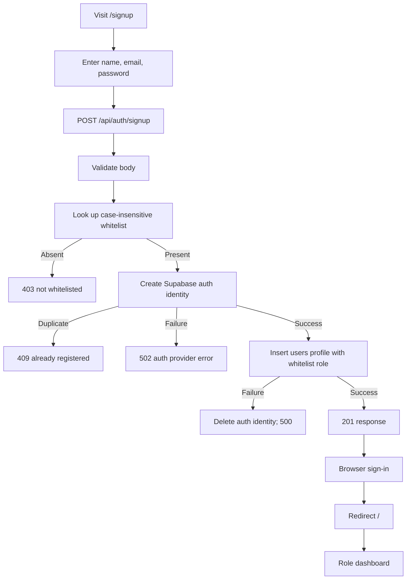
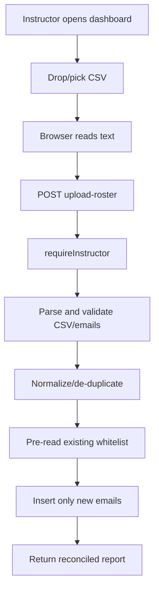
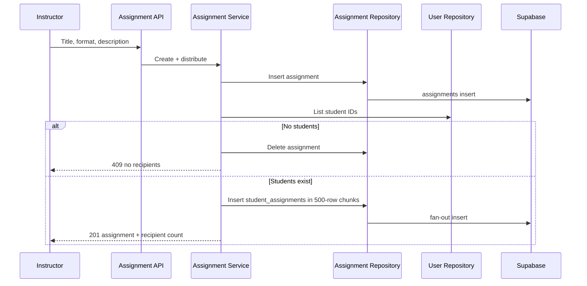
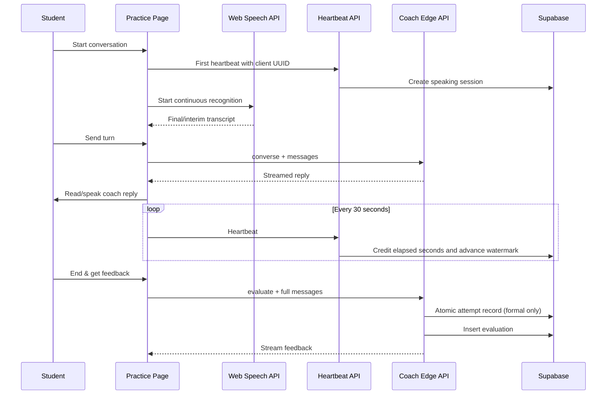
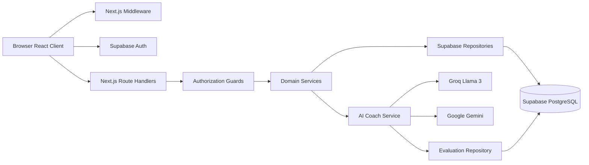
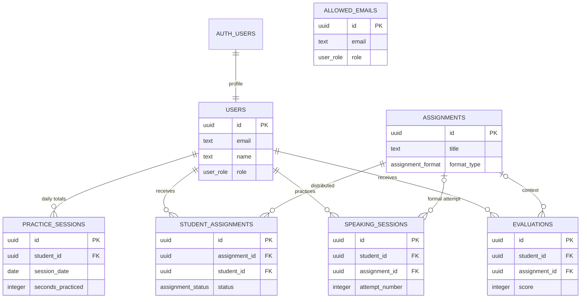

# SpeakCraft — Comprehensive Repository Specification

**Audit scope:** repository source, configuration, migrations, manifests, lockfile, and documentation.  
**Audit status:** implementation-aware repository audit; no application operations or external mutations were performed.  
**Primary evidence:** `src/**`, `supabase/migrations/**`, `package.json`, `package-lock.json`, `README.md`, `.env.local.example`, and build/configuration files.

## 1. Project Overview

### 1.1 Identity

- **Project name:** SpeakCraft
- **Package name/version:** `speakcraft` / `0.1.0`
- **Primary implementation:** Next.js 14 App Router application with TypeScript and Supabase.
- **Product summary:** An asynchronous, campus-oriented public-speaking practice platform for students and instructors.

### 1.2 Problem and Value Proposition

SpeakCraft provides:

- Whitelist-gated account creation and role assignment.
- Instructor-managed student rosters and cohort-wide speaking assignments.
- Student practice sessions with daily streak and practice-ceiling gamification.
- Client-side live speech transcription.
- Conversational AI coaching, followed by structured final feedback.
- Instructor compliance reporting.

The core value is combining practice tracking, assignment distribution, and voice coaching in one workflow. The repository states that it targets a 300-student cohort.

### 1.3 Target Users

- **Student:** Practices speaking, starts timed sessions, receives a streak summary, opens assigned tasks, converses with the coach, and receives final feedback.
- **Instructor:** Uploads/whitelists student emails, creates assignments, distributes them to enrolled students, and views cohort compliance.
- **Platform administrator / Supabase curator:** Provisioning is implied by management of `allowed_emails`, environment variables, migrations, and Supabase settings; no dedicated administrator UI or role is implemented.

### 1.4 Primary Use Cases

1. Sign up with a whitelisted campus email.
2. Sign in and be redirected to a role-specific dashboard.
3. Reset a password.
4. Instructor uploads a roster.
5. Instructor creates and distributes an assignment.
6. Student opens free practice or an assigned speaking task.
7. Student speaks in-browser while the server tracks governed practice time.
8. Student has a conversational AI coaching turn.
9. Student ends practice and receives structured feedback.
10. Instructor refreshes compliance metrics.

### 1.5 Current Implementation Status

- **Confirmed implemented:** Authentication, whitelist gating, role-based student/instructor route/API guards, roster ingestion, assignment distribution, student streak/progress tracking, Web Speech capture, conversational and evaluative AI coaching, evaluation persistence, and compliance metrics.
- **README-labelled phase status:** database/auth, instructor ecosystem, student heartbeat engine, multi-LLM coach, and atomic attempt guardrail are implemented at source level.
- **Scope limitations:** no project test suite, CI/CD configuration, dedicated production observability, file upload/storage service, or separate API framework is present.
- **Unverified operational state:** migrations' application to a live Supabase project, live provider availability, live auth configuration, deployment platform, and production data are UNKNOWN.

### 1.6 Confirmed vs. Inferred Decisions

**Confirmed by source:**

- The daily streak goal is 10 minutes.
- The daily credited practice ceiling is 30 minutes.
- Heartbeats are every 30 seconds.
- One heartbeat may credit at most 60 seconds.
- A formal assignment is limited to 4 attempts.
- Groq is primary and Gemini is fallback.
- The coach persona is “Coach Anaya.”
- UI use of the only brand accent is `#004CE5`.
- Web Speech recognition locale is `en-IN`.

**Inferred:**

- “Campus cohort” and 300-student scale are product assumptions stated in README/package metadata, not proven by deployed capacity evidence.
- Production deployment is intended for Next.js/Vercel-style serverless and Supabase, but no deployment provider is configured in repository files.

## 2. Product Functionality and Feature Inventory

| Feature | Problem addressed | Entry point / access | Behaviour and implementation | Status |
|---|---|---|---|---|
| Account signup | Restrict access to campus users | `/signup`; public; `POST /api/auth/signup` | Name, email, and password validation; whitelist lookup; auth identity creation; profile insertion; compensation delete on profile failure | IMPLEMENTED |
| Password sign-in | Authenticate campus users | `/login` | Supabase `signInWithPassword`; success redirects to `/`; error collapses to incorrect credentials | IMPLEMENTED |
| Password recovery | Recover account access | `/forgot`; `/reset` | Supabase reset email then PKCE/implicit/`PASSWORD_RECOVERY` recovery handling and `updateUser` | IMPLEMENTED |
| Role-aware root routing | Send authenticated users to the correct app | `/` | Server reads verified user and profile role, redirects student or instructor; missing profile/identity redirects login | IMPLEMENTED |
| Protected page routing | Prevent anonymous protected-page access | `/student*`, `/instructor*` | Middleware calls `auth.getUser()` and redirects unauthenticated visitors to `/login` | IMPLEMENTED |
| Roster upload | Add campus students to signup whitelist | `/instructor`; `POST /api/instructor/upload-roster` | CSV/text or emails array; CSV parse; email extraction/validation; dedupe; whitelist batch insert; reconciled result | IMPLEMENTED |
| Assignment composer | Dispatch speaking tasks | `/instructor`; `POST /api/instructor/create-assignment` | Title/format/description validation; insert assignment; resolve enrolled students; fan out `student_assignments`; compensation delete on failure | IMPLEMENTED |
| Compliance tracker | Monitor cohort progress | `/instructor`; `GET /api/instructor/metrics` | Manual load/refresh; read metrics view; show completion, assigned/completed counts, sessions, and practice seconds | IMPLEMENTED |
| Student dashboard | Central student progress and actions | `/student` | Streak block, free-practice action, assignment cards | IMPLEMENTED |
| Daily streak summary | Encourage daily practice | `GET /api/student/streak` | UTC daily history, 10-minute qualifying goal, consecutive streak, longest streak, at-risk status | IMPLEMENTED |
| Assignment cards | Show issued tasks and attempts | `GET /api/student/assignments` | Assignment data, status, attempts used/remain, attempt button disabled at zero | IMPLEMENTED |
| Timed practice heartbeat | Credit practice time securely | `/student/practice`; `POST /api/student/heartbeat` | Client-generated session ID; server elapsed computation; 60-second per-beat cap; 30-minute daily cap | IMPLEMENTED |
| Speech recognition | Capture spoken text | `/student/practice` | Browser native SpeechRecognition; continuous/interim, `en-IN`, auto-restart; typed fallback where unsupported | IMPLEMENTED |
| Conversational coach | Keep the student speaking | `POST /api/coach/analyze`, mode `converse` | Short 1–3 sentence spoken reply, streamed and optionally synthesized, no persistence | IMPLEMENTED |
| Final AI feedback | Evaluate speaking session | `POST /api/coach/analyze`, mode `evaluate` | Streamed Praise / Constructive Critique / Motivation; persist transcript/feedback/metrics/provider; formal-attempt recording | IMPLEMENTED |
| Speech synthesis | Read coach replies aloud | Browser speechSynthesis | Female English voice heuristic, keepalive for Chrome, cancel on unmount/skip | IMPLEMENTED |
| Retake guardrail | Prevent unlimited formal retries | Heartbeat and coach finalization | 4 attempts/assignment, pre-check plus atomic database enforcement | IMPLEMENTED |
| Audio-storage protection | Keep microphone audio out of the backend | Voice practice | Browser SpeechRecognition only; only transcript text is sent; no audio upload/storage code | CONFIRMED |

### 2.1 Minor UI and State Behaviors

- Signup/login/reset forms display loading, disabled, success, invalid, and error states.
- Login and signup do not use browser native validation; submit handlers perform explicit checks.
- Roster dropzone supports click, keyboard activation, drag/drop, and file-name reset for re-selection.
- Roster reports added, already whitelisted, duplicates, rejected entries, and details for rejections.
- Assignment composer resets title/description/format after success.
- Compliance table has loading, error, empty, refresh, and per-row progress states.
- Streak block shows loading placeholders, error status, today progress, longest streak, ceiling, and recent history.
- Assignment cards show loading/empty/error states and attempt eligibility.
- Voice room shows listening, thinking, speaking, ready, evaluating, ended, aborted, and error states.
- Heartbeat retries transient network failures and stops on 403/409 or daily ceiling.
- Voice coach supports typed entry only when SpeechRecognition is unsupported.
- Browser SpeechRecognition permission and recognition errors are surfaced, with benign `no-speech`/`aborted` suppression.

## 3. User Roles, Permissions and Access Control

### 3.1 Roles

The only application roles are `student` and `instructor`, defined in migration 0001 and reused by migration 0006.

### 3.2 Authentication

- Supabase Auth provides email/password identity.
- Signup pre-confirms email identities in the repository: `email_confirm: true`.
- Access checks call `auth.getUser()` for JWT validation rather than relying only on cookie presence.
- Browser authentication uses the public anon key.
- Server/admin operations use the service-role key.

### 3.3 Authorization Matrix

| Capability | Student | Instructor | Anonymous |
|---|---:|---:|---:|
| `/student*` pages | Allowed after middleware auth | Middleware allows auth but APIs reject role | Redirected `/login` |
| `/instructor*` pages | Middleware allows auth but APIs reject role | Allowed | Redirected `/login` |
| Signup/login/reset | Public | Public | Public |
| Signup API | Public, but whitelist-gated | Public, but whitelist-gated | Public |
| Heartbeat/assignments/streak | Allowed | 403 | 401 |
| Coach stream | Allowed | 403 | 401 |
| Roster upload | 403 | Allowed | 401 |
| Create assignment | 403 | Allowed | 401 |
| Metrics | 403 | Allowed | 401 |

### 3.4 Route-Level Protection

- Middleware protects `"/student"` and `"/instructor"` page prefixes.
- It does not prevent an authenticated wrong-role user from rendering a role page; API authorization is expected to be the enforced role boundary.
- API routes call `requireStudent()` or `requireInstructor()` themselves.
- `/` is session-aware and role-aware.
- `/login` and `/signup` are deliberately not redirected by middleware.

### 3.5 RLS and Missing Protections

- RLS is enabled on every table.
- `allowed_emails` has no client policies.
- `users` permits self select/update only.
- `assignments` permits authenticated selects.
- Student-owned tables permit only matching-user RLS operations.
- The privileged backend bypasses RLS with the service-role client.
- There is no application-level administrator role or route.
- A whitelist curator can assign role by adding `allowed_emails.role`; no role-management UI is implemented.
- **NOT IMPLEMENTED:** explicit route-level role guard in React/Server Component for wrong-role `/instructor` or `/student` access. The API guards reject wrong-role operations, but the page shell itself may initially render before API calls reject.

## 4. User Journeys and End-to-End Workflows

### 4.1 Signup



**Recovery:** profile failure compensates auth identity; client can retry login or signup.

### 4.2 Instructor Roster Ingestion



### 4.3 Assignment Distribution



If a later chunk fails, the service attempts to delete the assignment so the assignment does not survive a partial fan-out.

### 4.4 Student Practice and Coaching



**Alternate paths:**

- Browser lacks SpeechRecognition: typed entry replaces microphone capture.
- SpeechRecognition denied: error shown; no transcription.
- Daily 30-minute cap reached: heartbeat stops but current feedback can still finish.
- Free practice: no formal attempt or assignment completion.
- Formal assignment with no attempts left: practice start is disabled; server pre-check also returns 409.
- Both AI providers fail or stream with no usable final feedback: no formal attempt is consumed.

## 5. Technical Architecture

### 5.1 Architecture Overview



### 5.2 Frontend Architecture

- Next.js App Router in `src/app`.
- Server components: root layout, dashboard shells, session-aware `/`.
- Client components: auth, instructor widgets, student widgets, practice voice room.
- Presentation components receive DTOs and maintain local state machines.
- Navigation uses Next.js `Link` and `useRouter`.
- State is primarily React `useState`/`useRef`; no Redux/Zustand/store library.
- Browser speech APIs are direct browser capabilities.
- Tailwind CSS defines the light brand system.

### 5.3 Backend Architecture

The backend is a layered TypeScript implementation:

1. **Presentation/controller:** Next.js route handlers.
2. **DTO:** runtime validation and client-facing types.
3. **Service:** domain/business orchestration.
4. **Repository:** Supabase/PostgreSQL access.
5. **Entity:** typed database rows.
6. **Cross-cutting:** authorization, error mapping, environment access.

Routes do not contain core business logic beyond parse/delegate/error translation.

### 5.4 Communication

- Browser-to-auth: Supabase browser SDK.
- Browser-to-app: JSON `fetch` against route handlers.
- Coach: streaming `text/plain` Edge `Response`.
- Server-to-database: Supabase JS service-role or RLS-constrained clients.
- Groq: `groq-sdk`.
- Gemini: `@google/genai`.

### 5.5 Rendering and Runtime

- App Router in Next.js 14.
- Standard route handlers use Node.js runtime.
- `/api/coach/analyze` runs on Edge runtime.
- React strict mode is enabled.
- API mutating/read routes set `dynamic = "force-dynamic"` and do not cache.
- Middleware refreshes Supabase auth cookies and protects pages.

## 6. Complete Technology Stack

| Technology | Resolved/manifest version | Purpose | Evidence |
|---|---|---|---|
| Next.js | 14.2.35 | App Router framework, routing, middleware, route handlers | `package.json`, lockfile |
| React | 18.3.1 | UI/component runtime | `package.json`, lockfile |
| React DOM | 18.3.1 | Browser rendering | `package.json`, lockfile |
| TypeScript | 5.9.3 resolved (manifest `^5.5.4`) | Strict application typing | lockfile, `tsconfig.json` |
| Tailwind CSS | 3.4.19 resolved | Utility styling | lockfile, `tailwind.config.ts` |
| PostCSS | 8.5.16 resolved; Next nested 8.4.31 | CSS pipeline | lockfile, `postcss.config.mjs` |
| Autoprefixer | 10.5.2 resolved | Vendor prefixing | lockfile |
| Supabase JS | 2.109.0 resolved (manifest `^2.45.4`) | Auth and database SDK | lockfile |
| Supabase SSR | 0.5.2 | Browser/server cookie integration | lockfile |
| Groq SDK | 1.3.0 | Primary LLM streaming | lockfile |
| Google Gen AI SDK | 2.10.0 | Gemini fallback streaming | lockfile |
| PostgreSQL | UNKNOWN deployed version | Supabase database engine | SQL migrations |
| Supabase Auth | UNKNOWN hosted version | Identity/password/recovery | source |
| Web Speech API | Browser-dependent | Microphone transcription/synthesis | browser hooks |
| Mermaid | Documentation only | Architecture/workflow diagrams | this specification |

Node.js runtime version is **UNKNOWN**. Supabase hosted project region, database version, and deployment platform are **UNKNOWN**.

## 7. Complete Library and Dependency Inventory

### 7.1 Direct Runtime Dependencies

| Package | Resolved version | Use |
|---|---|---|
| `@google/genai` | 2.10.0 | Gemini streaming, provider fallback |
| `@supabase/ssr` | 0.5.2 | Browser/server Supabase auth-cookie clients |
| `@supabase/supabase-js` | 2.109.0 | Auth, PostgREST, RPC |
| `groq-sdk` | 1.3.0 | Groq chat-completion streaming |
| `next` | 14.2.35 | Framework/runtime |
| `react` | 18.3.1 | UI |
| `react-dom` | 18.3.1 | DOM renderer |

### 7.2 Direct Development Dependencies

| Package | Resolved version | Use |
|---|---|---|
| `@types/node` | 20.19.43 | Node declarations |
| `@types/react` | 18.3.31 | React declarations |
| `@types/react-dom` | 18.3.7 | React DOM declarations |
| `autoprefixer` | 10.5.2 | CSS vendor prefixing |
| `postcss` | 8.5.16 resolved | CSS processing |
| `tailwindcss` | 3.4.19 resolved | Utility CSS |
| `typescript` | 5.9.3 resolved | Compiler and type-checker |

### 7.3 Relevant Transitive/Critical Dependencies

- Next.js bundles the SWC toolchain and internal PostCSS/Babel utilities.
- Supabase JS includes auth, functions, postgrest, realtime, and storage subclients; only auth and PostgREST/RPC patterns are evident.
- `@google/genai` includes Google auth/protobuf/websocket dependencies as transitive critical support.
- `groq-sdk` includes HTTP/streaming support and is direct evidence of provider integration.
- The repository does not enumerate transitive dependencies individually in source; lockfile is authoritative and complete for installed packages.

### 7.4 Internal Shared Modules

- `src/backend/shared/app-error.ts`: typed HTTP/domain errors.
- `src/backend/shared/http.ts`: JSON error envelope and error mapper.
- `src/lib/env.ts`: centralized environment access.
- `src/lib/csv.ts`: CSV parser.
- `src/lib/format.ts`: duration and percentage formatting.
- `src/lib/supabase/*`: browser, server, and admin factories.
- `src/components/auth/AuthShell.tsx`: shared authentication shell.

## 8. API and Integration Documentation

### 8.1 `POST /api/auth/signup`

- Runtime: Node.js.
- Auth: public, whitelist-gated.
- Body: `{ email: string, password: string, name: string }`.
- Validation:
  - email required and syntactically valid; lower-cased.
  - password required, minimum 8 characters.
  - name required, trimmed, maximum 120 characters.
- Success: `201` `{ user: { id, email, name, role, createdAt } }`.
- Errors:
  - `400 VALIDATION_ERROR`
  - `403 EMAIL_NOT_WHITELISTED`
  - `409 EMAIL_ALREADY_REGISTERED`
  - `502 AUTH_PROVIDER_ERROR`
  - `500 PROFILE_PERSISTENCE_ERROR/INTERNAL_ERROR`
- Persistence: whitelist read, auth identity insert, users profile insert/delete compensation.

### 8.2 `POST /api/instructor/upload-roster`

- Runtime: Node.js.
- Auth: instructor only.
- Body: `{ csv: string }` or `{ emails: string[] }`.
- Validation: email extraction, syntax, control-character stripping, lower-case normalization, maximum 5,000 candidates, in-file deduplication.
- Success: `200` `{ received, added, alreadyWhitelisted, duplicatesInFile, rejected }`.
- Errors: `400`, `401`, `403`, `500`.
- Persistence: `allowed_emails` batch insert.

### 8.3 `POST /api/instructor/create-assignment`

- Runtime: Node.js.
- Auth: instructor only.
- Body: `{ title, formatType, description? }`.
- Validation: title 1–200 characters; format one of `extempore`, `debate`, `declamation`; description 0–5,000 characters.
- Success: `201` `{ assignment, recipientCount }`.
- Errors: `400`, `401`, `403`, `409` no recipients, `500`.
- Persistence: assignment insert and student distribution inserts; compensation deletes on fan-out failure.

### 8.4 `GET /api/instructor/metrics`

- Runtime: Node.js.
- Auth: instructor only.
- Success: `200` `{ students, studentCount }`.
- Errors: `401`, `403`, `500`.
- Data source: `student_compliance_metrics` view.

### 8.5 `GET /api/student/assignments`

- Runtime: Node.js.
- Auth: student only.
- Success: `200` `{ assignments: [...] }`.
- Errors: `401`, `403`, `500`.
- Data: student distributions plus attempts and remaining-attempt projections.

### 8.6 `GET /api/student/streak`

- Runtime: Node.js.
- Auth: student only.
- Success: `200` streak summary.
- Errors: `401`, `403`, `500`.
- Data: all UTC practice-day rows for the student, so longest-streak calculations are not capped by an arbitrary history window.

### 8.7 `POST /api/student/heartbeat`

- Runtime: Node.js.
- Auth: student only.
- Body: `{ sessionId: UUID, assignmentId?: UUID }`.
- Validation: UUIDs, no client-supplied duration.
- Success: `200` governed heartbeat totals and attempt/session signals.
- Errors: `400`, `401`, `403` ownership, `409` attempt ceiling, `500`.
- Data: server elapsed, session/assignment ownership, daily accumulator.
- Implementation: the Node route delegates to the `record_practice_heartbeat` PostgreSQL RPC. The migration uses a per-student transaction advisory lock, server-authoritative elapsed time, monotonic heartbeat watermark advancement, assignment-distribution ownership validation, and atomic daily/session writes.
- Migration: `supabase/migrations/0007_atomic_heartbeat_engine.sql`; it has been authored and tested in static/unit coverage but is not confirmed applied to a deployed database.

### 8.8 `POST /api/coach/analyze`

- Runtime: Edge.
- Auth: student only.
- Body: `{ mode: "converse"|"evaluate", assignmentId?: UUID, messages: [{ role:"student"| "coach", content:string }] }`.
- Validation:
  - mode required and exact.
  - optional valid UUID assignment.
  - 1–60 turns.
  - 24,000 total characters; 4,000 chars per turn.
  - at least one student turn.
- Pre-stream success: `200 text/plain` chunk stream.
- Pre-stream errors: `400`, `401`, `403`, `503` no provider, `500`.
- Behavior after stream starts: provider failures append apology/fallback text; no HTTP status can change.
- Timeout/cancellation: Groq and Gemini receive separate 25-second timeout signals. Groq pre-token failure falls back to Gemini. Client cancellation stops fallback and provider work. Mid-stream Groq failure appends an ellipsis instead of restarting the partial response.

### 8.9 Supabase Auth Browser Calls

There are no additional custom auth routes:

- `signInWithPassword`
- `resetPasswordForEmail`
- `exchangeCodeForSession`
- `getSession`
- `onAuthStateChange`
- `updateUser`

These contracts are delegated to Supabase; exact hosted behavior and redirect allow-list configuration are UNKNOWN.

## 9. Database and Data Model Documentation

### 9.1 Database

- Engine: PostgreSQL hosted by Supabase.
- Schema: `public`.
- Extensions: `pgcrypto`.
- Primary keys: mostly UUID.
- RLS: enabled on all tables.
- Deployed database state: UNKNOWN.

### 9.2 Entities

| Table/View | Purpose | Key fields |
|---|---|---|
| `allowed_emails` | Campus whitelist and signup role grant | `id`, `email`, `role`, `created_at`; case-insensitive unique email |
| `users` | Profile keyed 1:1 to `auth.users` | `id`, `email`, `name`, `role`, `created_at`; email cascade bound to auth |
| `assignments` | Instructor-created speaking tasks | `id`, `title`, `format_type`, `description`, `created_at` |
| `practice_sessions` | Per-student/per-day practice accumulator | `id`, `student_id`, `seconds_practiced`, `session_date`; unique `(student_id, session_date)` |
| `student_assignments` | Assignment-to-student fan-out/status | `id`, `assignment_id`, `student_id`, `status`, `assigned_at`, `completed_at`; unique pair |
| `speaking_sessions` | Timed sessions/assignment attempt ledger | `id`, `student_id`, `assignment_id`, `attempt_number`, `seconds_accumulated`, `status`, timestamps |
| `evaluations` | Final text coaching result | `id`, student/assignment/attempt, `transcript`, `feedback`, `score`, `provider`, word/filler metrics, `created_at` |
| `student_compliance_metrics` | Instructor metrics view | student identity, assigned/completed counts, practice seconds, session count |

### 9.3 Enums

- `user_role`: `student`, `instructor`
- `assignment_format`: `extempore`, `debate`, `declamation`
- `assignment_status`: `assigned`, `completed`
- `speaking_session_status`: `active`, `ended`
- `ai_provider`: `groq`, `gemini`

### 9.4 Relationships

- `users.id -> auth.users.id`, cascade delete.
- `practice_sessions.student_id -> users.id`, cascade delete.
- `student_assignments.assignment_id -> assignments.id`, cascade delete.
- `student_assignments.student_id -> users.id`, cascade delete.
- `speaking_sessions.student_id -> users.id`, cascade delete.
- `speaking_sessions.assignment_id -> assignments.id`, null on delete.
- `evaluations.student_id -> users.id`, cascade delete.
- `evaluations.assignment_id -> assignments.id`, null on delete.

### 9.5 Constraints and Indexes

- Case-insensitive unique indexes on whitelist emails and user emails.
- Practice sessions unique per `(student_id, session_date)`.
- Student assignments unique per `(assignment_id, student_id)`.
- Speaking attempts unique per `(assignment_id, student_id, attempt_number)`.
- Nonnegative seconds and bounded evaluation score.
- Attempt number positive when present.
- Word/filler counts nonnegative.
- Indexes support student/date, student/assignment, assignments, and evaluation histories.

### 9.6 ER Diagram



## 10. Business Logic and Rules

| Rule | Implemented behavior | Evidence |
|---|---|---|
| Whitelist gate | Signup allowed only if email exists; lookup before writes | `auth.service.ts`, `user.repository.ts` |
| Role comes from whitelist | Profile role copied from `allowed_emails.role` | `auth.service.ts`, migration 0006 |
| Profile compensation | Delete auth identity if profile insert fails | `auth.service.ts`, `user.repository.ts` |
| Assignment formats | Only extempore/debate/declamation | assignment DTO/entity/migration |
| Assignment blast | One distribution row per enrolled student | instructor service/repository |
| No-recipient rollback | Assignment deleted if no students | instructor service |
| Distribution failure rollback | Assignment delete compensation | instructor service |
| Daily practice goal | 10 minutes; UTC day qualifies streak | practice-policy, student service |
| Daily cap | 30 credited minutes/day | practice-policy, student service |
| Heartbeat interval | 30 seconds | practice policy/hook |
| Per-beat maximum | 60 seconds | practice policy |
| Credit formula | `min(elapsed, 60 seconds, remaining daily allowance)` | student service |
| Watermark rule | Always advance to server `now` | student service |
| Streak current anchor | Today if met; otherwise yesterday if met | student service |
| Longest streak | Max consecutive UTC qualifying-day run | student service |
| Streak history | All practice-day rows are retrieved; no 400-day application limit | session repository/student service |
| Formal assignment ownership | Formal heartbeat/coach evaluate requires a matching `student_assignments` row | student service + heartbeat RPC |
| Retake ceiling | Maximum 4 formal attempts/assignment | practice policy |
| Atomic retake enforcement | Advisory lock + recount + insert + completion in same transaction | migration 0005 |
| Unique attempt backstop | `(assignment_id, student_id, attempt_number)` unique | migration 0005 |
| Coaching attempt | Only successful evaluate content with student transcript consumes attempt | AI service |
| Free practice | No formal attempt number; no assignment completion | AI/student services |
| Provider failover | Groq first; Gemini only if Groq has emitted no token | AI coach service |
| Delivery score | 55–100 proxy based on filler density and length | AI coach service |

No client-supplied practice duration is accepted or stored by the heartbeat API.

## 11. Validation, Error Handling and Edge Cases

| Scenario | Expected/actual behavior | Status | Evidence |
|---|---|---|---|
| Malformed JSON | Stable `400 VALIDATION_ERROR` | HANDLED | route handlers |
| Missing/invalid signup fields | Field-level validation details | HANDLED | signup DTO/page |
| Whitelist missing | 403 | HANDLED | auth service |
| Duplicate auth email | 409 | HANDLED | auth repository |
| Auth/profile split failure | Compensating auth identity delete; 500 | PARTIALLY HANDLED | delete is best-effort |
| Invalid heartbeat UUID | 400 | HANDLED | heartbeat DTO |
| Session belongs to another student | 403 | HANDLED | student service |
| Network heartbeat failure | UI keeps interval; retries next tick | HANDLED | useHeartbeat |
| 403/409 heartbeat | Stop and show message | HANDLED | useHeartbeat |
| Daily cap reached | Stop heartbeat | HANDLED | student service/hook |
| Dropped heartbeat | Server elapsed reconciliation; watermark advances | HANDLED | student service |
| Concurrent heartbeat write | Per-student advisory lock + atomic RPC | IMPLEMENTED; live PostgreSQL verification required | migration 0007 |
| Backward/server clock change | Heartbeat watermark never moves backward | HANDLED in migration; live verification required | migration 0007 |
| Assignment mismatch or unassigned formal practice | RPC/API rejects mismatched/unassigned assignment | HANDLED; live repository verification required | student service, migration 0007 |
| Concurrent coaching attempts | Atomic DB function/advisory lock/unique constraint | HANDLED | migration 0005 |
| No assignment recipients | 409 and assignment compensation delete | HANDLED | instructor service |
| Partial assignment fan-out | Service attempts assignment deletion | PARTIALLY HANDLED | delete is best-effort |
| Empty/invalid roster | 400; no valid emails return 400 | HANDLED | roster DTO |
| Roster candidate > 5,000 | 400 | HANDLED | roster DTO |
| Duplicate roster entry | Collapsed and counted | HANDLED | roster DTO |
| NUL/control characters | Stripped before validation/database | HANDLED | CSV/roster utilities |
| CSV with quotes/newlines | Dependency-free parser support | HANDLED | `src/lib/csv.ts` |
| Assignment title/format/description bounds | 400 on violation | HANDLED | assignment DTO |
| SpeechRecognition unsupported | Typed fallback | HANDLED | practice page/hook |
| Microphone denied | Permission error displayed | HANDLED | recognition hook |
| Recognition no-speech | Benign; no error | HANDLED | recognition hook |
| Recognition restart failure | Listening state is cleared | PARTIALLY HANDLED | recognition hook |
| No student in conversation | Final feedback error; no evaluation | HANDLED | practice page/AI DTO |
| Provider entirely unconfigured | 503 before stream | HANDLED | route/service |
| Groq fails before first token | Gemini fallback | HANDLED | AI service |
| Groq fails after token | Append ellipsis; do not restart | HANDLED | AI service |
| Both providers fail mid-stream | Apology appended; stream closes | HANDLED | AI service |
| Evaluate stream has empty text | No attempt/evaluation persisted | HANDLED | AI service |
| Evaluation finalization fails | Error logged; feedback may still stream | PARTIALLY HANDLED | AI service |
| Evaluation persistence fails | Error logged; formal attempt may still have been recorded | NOT GUARANTEED ATOMIC | AI service/repository |
| Unknown API exception | 500 opaque JSON; server logs | HANDLED | shared HTTP mapper |
| Stale assignment context | Coach proceeds or context lookup may fail | PARTIALLY HANDLED | assignment lookup |
| Stale dashboard data | No-store fetch, manual/return refresh | HANDLED/PARTIAL | client components |
| Browser tab throttling | 30s interval but server max 60-second credit | HANDLED | heartbeat hook/service |
| Browser leaves practice page | Interval cleared on unmount; heartbeat stops | HANDLED | hook |

Generic `try/catch` blocks are used in some UI flows, but each confirmed behavior above is evidenced by a distinct response or state change rather than assumed from catch-only code.

## 12. Security and Privacy

### 12.1 Implemented Protections

- Supabase service-role key is server-only and modules use `import "server-only"`.
- Public browser config is limited to Supabase URL and anon key.
- Public env accessors are literal/validated.
- RLS is enabled on all tables.
- API role guards validate Supabase JWT via `auth.getUser()` and profile role.
- Whitelist prevents signup identities outside the curated email set.
- Passwords are not persisted by application code and are sent to Supabase Auth.
- HTTP returns typed, client-safe error envelopes.
- Login and forgot-password behavior avoid enumerating account status.
- Coach sends text only; no audio storage/upload implementation exists.
- CSV control characters are stripped.
- Rich-text rendering uses plain text node/`<strong>` splitting and does not inject HTML.
- The coach record has server-side SQL constraints and formal-attempt locking.
- Supabase RPC attempt function pins `search_path` and grants execute only to `service_role`.

### 12.2 Gaps and Risks

- **CONFIRMED ISSUE:** `.env.local.example` is tracked and appears to contain populated credentials rather than placeholders. Secrets should be revoked/rotated if valid and replaced with placeholders.
- **CONFIRMED ISSUE:** a `.env.local` file exists locally. It is gitignored, but this specification does not expose values.
- **POTENTIAL ISSUE:** no CSRF-specific middleware is evident for Next route handlers. Supabase cookie auth is the primary session mechanism; route mutability and same-origin behavior require operational verification.
- **POTENTIAL ISSUE:** no explicit CORS configuration is present. Next routes are same-origin in the implemented UI; cross-origin API exposure is not documented.
- **POTENTIAL ISSUE:** no rate limiting is implemented for signup, login, roster upload, assignment creation, heartbeat, or coach.
- **POTENTIAL ISSUE:** no application audit/log retention system is implemented.
- **POTENTIAL ISSUE:** user transcripts and coach feedback are stored in `evaluations`, which may be personal/sensitive; retention and deletion policy is UNKNOWN.
- **POTENTIAL ISSUE:** the `practice_sessions` heartbeat read-modify-write is not transaction-wrapped.
- **POTENTIAL ISSUE:** assignment fan-out rollback is best-effort and can leave an orphaned row if delete compensation fails.
- **POTENTIAL ISSUE:** evaluation persistence is not in the same transaction as formal-attempt finalization, so a failure could leave attempt count and evaluation inconsistent.
- **UNKNOWN:** deployed Supabase Auth redirect URL allow-lists and email provider settings.
- **UNKNOWN:** production XSS/CSRF headers and CSP.

## 13. Environment Variables and Configuration

| Variable | Scope | Required | Purpose | Behavior if missing |
|---|---|---|---|---|
| `NEXT_PUBLIC_SUPABASE_URL` | Public browser/server | Required | Supabase project URL | `publicEnv.supabaseUrl()` throws descriptive error |
| `NEXT_PUBLIC_SUPABASE_ANON_KEY` | Public browser/server | Required | RLS-constrained Supabase client | `publicEnv.supabaseAnonKey()` throws |
| `SUPABASE_SERVICE_ROLE_KEY` | Server-only | Required | Privileged backend/repository client | `serverEnv.supabaseServiceRoleKey()` throws |
| `GROQ_API_KEY` | Server-only | Optional | Groq primary provider | Groq skipped; Gemini or 503 |
| `GEMINI_API_KEY` | Server-only | Optional | Gemini fallback provider | Gemini skipped; Groq or 503 |

The actual values are not reproduced in this specification.

### 13.1 Configuration Files

- `package.json`: scripts and direct dependencies.
- `package-lock.json`: resolved dependency graph.
- `tsconfig.json`: strict ES2022 TypeScript; no emit; App Router alias `@/* -> src/*`.
- `next.config.mjs`: React strict mode.
- `tailwind.config.ts`: brand and surface design tokens.
- `postcss.config.mjs`: Tailwind + Autoprefixer.
- `.env.local.example`: documented environment contract; file contains populated credential-like values, should be replaced/rotated.
- `.gitignore`: excludes env and build output.
- `supabase/migrations/*.sql`: schema, RLS, views, functions.

## 14. External Services and Integrations

| Service | Purpose | Method | Failure behavior | Operational dependency |
|---|---|---|---|---|
| Supabase Auth | Signup, login, password reset, session validation | Supabase SSR/browser/admin SDK | Auth requests produce typed errors or 401/502; signup rollback on profile failure | Required for all protected workflows |
| Supabase PostgreSQL/PostgREST | Data, RLS, RPC | Supabase JS service-role/admin and RLS clients | Domain 500/metrics/streak/session errors | Required for persistence |
| Groq | Primary streaming coach | `groq-sdk`, Llama 3 model | Pre-first-token failure falls back to Gemini; mid-stream failure appends ellipsis | Optional if Gemini configured |
| Google Gemini | Fallback streaming coach | `@google/genai`, Gemini Flash | Mid/pre-stream failure produces coaching error/apology | Optional if Groq configured |
| Web Speech Recognition | Browser microphone transcription | Browser vendor API | Unsupported/denied falls back to typed or surfaces error | Optional browser capability |
| Web Speech Synthesis | Read coach aloud | Browser SpeechSynthesis API | TTS unavailable silently or synthesis errors call completion | Optional browser capability |

The Groq model is `llama-3.3-70b-versatile`; Gemini model is `gemini-2.0-flash`; temperature is `0.6`; max output is `1024` tokens. These are confirmed source constants.

## 15. Testing and Quality Assurance

- - Vitest `2.1.9` provides unit/integration coverage.
- Playwright `1.65.1` provides Chromium browser verification.
- Scripts exist for `test`, `test:coverage`, `test:e2e`, `typecheck`, `lint`, and `build`.
- Database scripts exist for `db:start`, `db:stop`, `db:reset`, `db:seed`, and `db:verify`.
- Unit coverage includes DTO validation, whitelist auth lifecycle, instructor distribution/rollbacks, student streak/heartbeat delegation/assignment ownership, AI metrics/fallback/cancellation, and static heartbeat migration invariants.
- Browser tests cover public login, signup, and forgot-password pages.
- No CI workflow or live-Supabase test environment is implemented.
- **Known untested live areas:** RLS behavior, live provider latency/failover, live migration execution, concurrent PostgreSQL heartbeats, and database `EXPLAIN ANALYZE`.

## 16. Deployment and Infrastructure

### 16.1 Local Setup

```bash
npm install
cp .env.local.example .env.local
npm run dev
```

Local Supabase/PostgreSQL setup:

```bash
open -a Docker
brew install supabase/tap/supabase
supabase init
supabase start
npm run db:seed
npm run db:verify
```

The local setup is Supabase-compatible and applies migrations through the existing `supabase/migrations/*.sql` directory.
The seed creates synthetic `@local.test` identities and must not be used against production.
The benchmark seed initializes nullable Supabase Auth token fields to empty strings so local GoTrue password sign-in works with these synthetic identities. The API load-test harness is loopback-only; it reuses the 300 synthetic students and provisions one synthetic instructor for instructor-only routes.

From README:

- Dev URL: `http://localhost:3000`
- Supabase migrations: apply 0001 or migration set to the target project.
- Seed whitelist example: SQL editor insert of `allowed_emails`.
- API load test: `npm run loadtest:setup`, `npm run loadtest:smoke`, then `npm run loadtest:api`; raw k6 output is stored under `load-tests/results/`.

### 16.2 Scripts

| Script | Command | Purpose |
|---|---|---|
| `dev` | `next dev` | Local development |
| `build` | `next build` | Production build |
| `start` | `next start` | Production Next start |
| `lint` | `eslint . --max-warnings=0` | ESLint |
| `typecheck` | `tsc --noEmit` | Strict type checking |
| `test` | `vitest run` | Unit/integration tests |
| `test:coverage` | `vitest run --coverage` | Unit coverage |
| `test:e2e` | `playwright test` | Managed Chromium browser tests |
| `db:start` | `supabase start` | Start local Supabase stack |
| `db:stop` | `supabase stop` | Stop local Supabase stack |
| `db:reset` | `supabase db reset --yes` | Reset local database and apply migrations/seed |
| `db:seed` | `docker exec ... psql < supabase/seed.sql` | Reset and recreate synthetic benchmark data |
| `db:verify` | `tsx scripts/local-db-benchmark.ts` | Run local correctness and benchmark harness |
| `loadtest:setup` | `node load-tests/run-local.mjs setup` | Provision the synthetic local instructor and validate the fixture |
| `loadtest:smoke` | `node load-tests/run-local.mjs smoke` | Smoke-test local APIs and heartbeat correctness |
| `loadtest:api` | `node load-tests/run-local.mjs benchmark` | Run bounded localhost k6 API load scenarios |
| `loadtest:cleanup` | `node load-tests/run-local.mjs cleanup` | Remove synthetic load-test rows after an interrupted run |

### 16.3 Deployment

- Deployment platform: UNKNOWN.
- Hosting config: none beyond Next configuration.
- Database migration process: manual SQL editor or Supabase CLI is documented, but Supabase CLI config is not in the repository.
- CI/CD: none present.
- Edge support: `/api/coach/analyze` edge runtime.
- Node routes: standard Node runtime.
- Production database/service provisioning: UNKNOWN.

## 17. Observability and Operational Behaviour

### 17.1 Logging

- `console.error` is used for unhandled signup and API failures.
- `console.error`/`console.warn` is used for AI finalization and client API failures.
- Compliance, assignment, streak, and assignment-card UI log load failures.
- No structured logging library or centralized logger is implemented.

### 17.2 Missing Observability

- No health check endpoint.
- No analytics SDK.
- No error-reporting SDK.
- No metrics or tracing provider.
- No provider usage/cost dashboard.
- No database job scheduler.
- No background worker framework.
- No alerting configuration.
- No test dashboards or uptime probes.

### 17.3 Operationally Sensitive Behaviors

- Live heartbeat traffic is every 30 seconds per active practice session.
- Coach stream waits on external providers before and during token streaming.
- Daily accumulator is capped to 30 minutes per student/day.
- Student assignment metrics are read at request time from a database view.
- Assignment fan-out is chunked at 500 rows.
- Roster ingestion is capped at 5,000 candidates.
- AI conversations are capped at 60 turns and 24,000 combined chars.
- AI final evaluations are capped by 20,000 characters only in the legacy `validateAnalyzeRequest`, while the active coaching route uses the conversation limits.

## 18. Known Limitations and Technical Debt

| Item | Classification | Evidence/impact |
|---|---|---|
| No project-owned test suite | CONFIRMED ISSUE | package/scripts/source contain no application tests |
| No CI/CD pipeline config | CONFIRMED ISSUE | no workflow/deployment files found |
| `.env.local.example` appears credential-populated | CONFIRMED ISSUE | rotate/replace if values are valid |
| No rate limiting | CONFIRMED ISSUE | auth, roster, assignment, heartbeat, and coach endpoints lack repository rate-limit code |
| No explicit route lock for wrong role's page shell | CONFIRMED ISSUE | middleware authenticates only; APIs enforce role |
| Live heartbeat RPC not applied/verified | CONFIRMED OUTSTANDING | migration 0007 exists, but no local/staging PostgreSQL was available |
| Evaluation persistence not coupled atomically to attempt | POTENTIAL ISSUE | only attempt finalization uses SQL transaction |
| Roster/assignment compensation deletes are best-effort | CONFIRMED ISSUE | repository methods swallow compensation errors |
| No transcript/evaluation retrieval API | CONFIRMED ISSUE | only evaluation insert exists; no UI to view historical evaluations |
| No logout UI | POTENTIAL ISSUE | no sign-out call found in source; direct session expiry/sign-out behavior UNKNOWN |
| No role change/revoke UI | CONFIRMED ISSUE | `allowed_emails.role` is database-curated only |
| No assignment editing/deletion UI | CONFIRMED ISSUE | only assignment insert/distribution and delete compensation |
| No roster removal UI | CONFIRMED ISSUE | only batch insert |
| No historical assignment/evaluation pages | CONFIRMED ISSUE | student dashboard and practice room are the only major student surfaces |
| Legacy `validateAnalyzeRequest` vs active conversation DTO | POTENTIAL ISSUE | both exist; active route uses `validateCoachRequest` |
| Database type file is hand-authored | POTENTIAL ISSUE | may drift from live schema unless migrations regenerate it |
| Supabase hosted versions/regions unknown | REQUIRES INVESTIGATION | no infrastructure configuration in repository |
| Browser Speech API support is inconsistent | CONFIRMED LIMITATION | typed fallback plus browser-dependent synthesis/recognition |
| AI provider models/availability can change | REQUIRES INVESTIGATION | model names are hardcoded |
| No retention/deletion policy for transcript data | CONFIRMED GAP | evaluations store text indefinitely unless externally removed |
| No CORS/CSRF/rate-limit config | REQUIRES INVESTIGATION | same-origin UI only is evidence, not deployed policy |

## 19. File and Module Reference

| Path | Responsibility |
|---|---|
| `src/app/page.tsx` | Session-aware root redirect |
| `src/app/layout.tsx` | Root metadata and HTML shell |
| `src/app/login/page.tsx` | Password login |
| `src/app/signup/page.tsx` | Whitelist signup UI |
| `src/app/forgot/page.tsx` | Password recovery request |
| `src/app/reset/page.tsx` | Recovery-session/password update |
| `src/app/student/page.tsx` | Student dashboard shell |
| `src/app/student/_components/StudentDashboard.tsx` | Wires streak, free practice, and assignment cards |
| `src/app/student/_components/StreakBlock.tsx` | Streak and daily goal UI |
| `src/app/student/_components/AssignmentCards.tsx` | Assignment list/attempt UI |
| `src/app/student/_components/PracticeConsole.tsx` | Timed session presentational state |
| `src/app/student/_hooks/useHeartbeat.ts` | 30-second practice heartbeat/resilience |
| `src/app/student/practice/page.tsx` | Voice coaching room, conversation, feedback |
| `src/app/student/practice/_hooks/useSpeechRecognition.ts` | Browser transcription |
| `src/app/student/practice/_hooks/useSpeechSynthesis.ts` | Browser voice playback |
| `src/app/instructor/page.tsx` | Instructor dashboard shell |
| `src/app/instructor/_components/RosterUploader.tsx` | CSV drag/drop ingestion UI |
| `src/app/instructor/_components/AssignmentComposer.tsx` | Assignment creation UI |
| `src/app/instructor/_components/ComplianceTracker.tsx` | Compliance metrics UI |
| `src/app/api/auth/signup/route.ts` | Signup HTTP controller |
| `src/app/api/instructor/*/route.ts` | Instructor API controllers |
| `src/app/api/student/*/route.ts` | Student API controllers |
| `src/app/api/coach/analyze/route.ts` | Edge streaming coach controller |
| `src/backend/auth/authorization.ts` | Verified auth and role guards |
| `src/backend/user/*` | Signup, profile, whitelist DTO/service/repository/entities/errors |
| `src/backend/assignment/*` | Assignment/instructor DTO, entities, repository |
| `src/backend/roster/roster.dto.ts` | Roster parser/validator |
| `src/backend/instructor/*` | Instructor orchestration and errors |
| `src/backend/session/*` | Heartbeat/streak DTO, entities, repository |
| `src/backend/student/*` | Practice policy, orchestration, errors |
| `src/backend/ai/*` | Coach service, DTO/entity/repository/errors |
| `src/backend/shared/*` | Shared errors and HTTP mapping |
| `src/lib/supabase/*` | Browser/server/admin Supabase clients and database types |
| `src/lib/env.ts` | Validated environment access |
| `src/lib/csv.ts` | CSV parser |
| `src/lib/format.ts` | UI format helpers |
| `src/components/auth/AuthShell.tsx` | Shared authentication card layout |
| `src/middleware.ts` | Cookie refresh and protected page redirect |
| `supabase/migrations/0001_initial_schema.sql` | Base tables, enums, RLS |
| `supabase/migrations/0002_instructor_ecosystem.sql` | Distribution and compliance view |
| `supabase/migrations/0003_student_session_engine.sql` | Session and daily accumulator |
| `supabase/migrations/0004_ai_evaluations.sql` | Evaluation table and RLS |
| `supabase/migrations/0005_atomic_attempt_guardrail.sql` | Concurrency-safe coaching attempts |
| `supabase/migrations/0006_whitelist_role.sql` | Role grant on whitelist |
| `supabase/migrations/0007_atomic_heartbeat_engine.sql` | Atomic, locked heartbeat accumulation, assignment ownership, and monotonic watermark |

## 20. Product and Engineering Traceability Matrix

| Feature | User journey | Frontend | Backend | Database/APIs | Tests |
|---|---|---|---|---|---|
| Signup | Account creation | signup/login/root | signup route/auth service/user repository | `allowed_emails`, `users`, Auth; signup API | None |
| Password recovery | Forgot/reset | forgot/reset | Supabase browser auth | Supabase Auth | None |
| Roster | Whitelist campus users | RosterUploader/instructor page | instructor service/user repository/roster DTO | `allowed_emails`; upload-roster API | None |
| Assignments | Instructor dispatch to students | AssignmentComposer | instructor/assignment service/repository | `assignments`, `student_assignments`; create-assignment API | None |
| Compliance | Instructor monitoring | ComplianceTracker | instructor service/assignment repository | view and metrics API | None |
| Streak | Daily practice retention | StreakBlock/student dashboard | student/session service/repository | `practice_sessions`; streak API | None |
| Heartbeat | Timed practice | useHeartbeat/PracticeConsole/practice page | student/session service/repository | `speaking_sessions`, `practice_sessions`; heartbeat RPC; heartbeat API | Vitest delegation/streak/timeout/migration tests |
| Assignments for student | Practice issued task | AssignmentCards/practice page | student/assignment/session services | student assignments/sessions | None |
| Conversational coaching | Live back-and-forth | practice page/speech hooks | coach Edge route/AI service | Groq/Gemini external APIs | Vitest fallback/cancellation/metrics tests |
| Final evaluation | Structured feedback | practice page | AI service/evaluation repository | `evaluations`, provider APIs | None |
| Retake guardrail | Limit formal retries | assignment cards/practice page | student/AI service/Postgres function | `speaking_sessions`, `record_coaching_attempt` RPC | None |

## 21. Open Questions and Unverified Assumptions

### Facts

- The repository includes no live environment/deployment evidence.
- No project tests or CI/CD configuration exist.
- No deployed database can be verified from source.
- The `.env.local` values and migration application state are UNKNOWN.
- The actual Supabase project URL and keys should never be copied into documentation.

### Assumptions Requiring Confirmation

1. What product version/deployment is currently live?
2. Which exact migrations have been applied to the live database?
3. Is the 300-student capacity target a confirmed launch requirement?
4. Which browser support matrix is required for SpeechRecognition and SpeechSynthesis?
5. Should formal coaching attempt count occur only on a successful evaluation stream or on conversation completion regardless of provider?
6. Should transcript/evaluation data be retained, exportable, or deletable?
7. Is a logout/profile management journey required?
8. Are roster users allowed to have instructor role automatically by whitelist, or should role assignment be curated separately?
9. Are assignments allowed to be edited/deleted after distribution?
10. Is the authored atomic heartbeat migration acceptable for the target PostgreSQL/Supabase version, and is it approved for staging/production application?
11. What is the operational production rollback/compensation policy for partial migrations or external API failures?
12. What monitoring, uptime, and alerting requirements apply?
13. Are rate limiting, CORS, CSRF, CSP, and WAF controls configured outside repository/deployment configuration?
14. Are Groq and Gemini keys valid and active in the deployment environment?
15. Is Supabase email sender/recovery redirect configured in the hosted project?

## 22. Quick Reference

- **Application:** SpeakCraft, an asynchronous public-speaking practice platform for a campus cohort.
- **Core features:** whitelist signup, role dashboards, roster ingestion, assignment blast, compliance metrics, timed practice, streak tracking, live speech transcription, AI coaching, and evaluation storage.
- **Main entry points:** `/login`, `/signup`, `/forgot`, `/reset`, `/student`, `/student/practice`, `/instructor`.
- **Technology:** Next.js 14.2.35, React 18.3.1, TypeScript 5.9.3 resolved, Tailwind CSS 3.4.19 resolved, Supabase JS/SSR, Groq SDK, Google Gen AI SDK.
- **Main APIs:** auth signup, student heartbeat/assignments/streak, instructor roster/assignment/metrics, edge coach stream.
- **Database:** Supabase PostgreSQL with users, whitelist, assignments, distributions, practice and speaking sessions, evaluations, and a compliance view.
- **External integrations:** Supabase Auth/Postgres, Groq, Gemini, browser Speech Recognition/Synthesis.
- **Critical variables:** public Supabase URL/anon key, server Supabase service role key, Groq key, Gemini key.
- **Key limits:** 10-minute daily goal, 30-minute daily cap, 60-second heartbeat credit, 30-second cadence, 4 attempts/assignment, 5,000 roster rows, 60 conversation turns.
- **Most important limitation:** no project-owned tests or CI/CD.
- **Most important operational risks:** credential hygiene, provider availability, live migration state, Supabase configuration, and partial-failure consistency.
